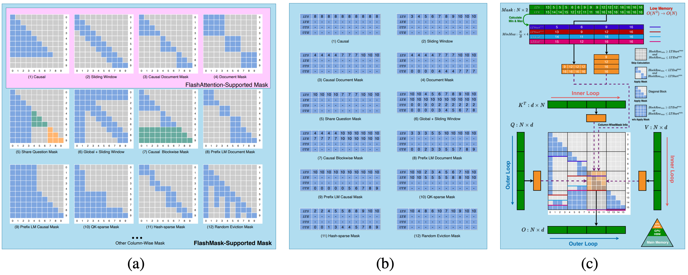
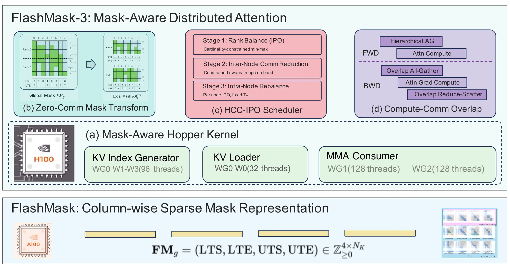
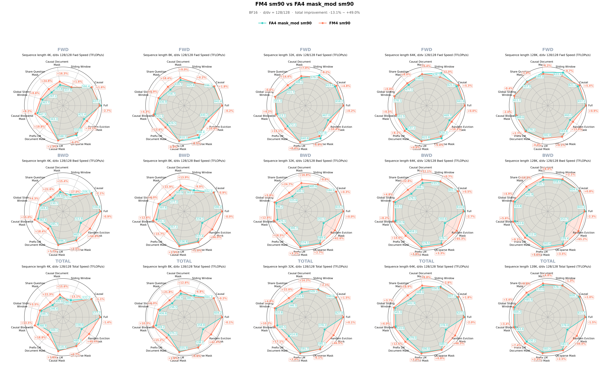
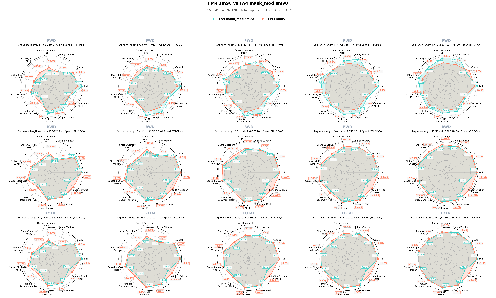
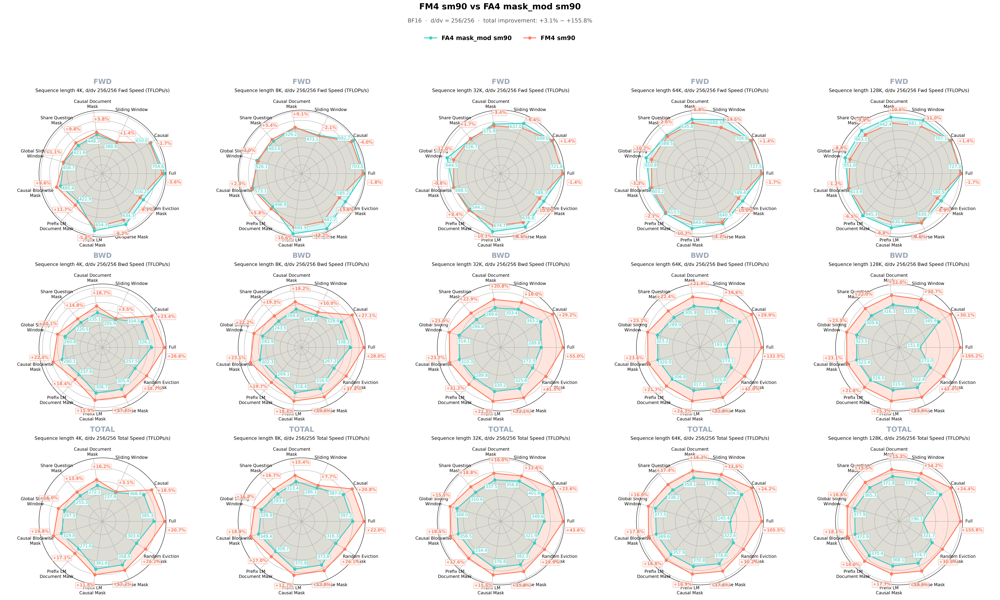

<div align="center">

# ⚡ FlashMask

**Flexible and Efficient Attention with Column-wise Sparse Masks**

[](https://arxiv.org/abs/2410.01359)
[](https://arxiv.org/abs/2610.17901)
[](LICENSE)
[](https://www.paddlepaddle.org.cn/)
[](https://pytorch.org/)

English | [简体中文](README.zh-CN.md)

<p align="center">
  
</p>
<p><i>Figure 1: FlashMask overview. (a) Supported mask types; (b) column-wise sparse representation; (c) efficient implementation</i></p>

<p align="center">
  
</p>
<p><i>Figure 2: FlashMask-3 across the four layers of the execution stack</i></p>

</div>


## 📋 Contents

- [News](#-news)
- [Overview](#-overview)
- [Key Features](#-key-features)
- [Performance](#-performance)
- [Installation](#-installation)
- [Quick Start](#-quick-start)
- [Citation](#-citation)
- [Acknowledgement](#-acknowledgement)
- [License](#-license)

---

## 📢 News
- **2026-09-25 FlashMask-4**: Supports Hopper and Blackwell. Kernels are JIT-compiled at runtime with CuTe DSL, so compilation is fast. Flexible masks are available at every supported head dim, with full support for sink bias and deterministic computation, plus large head dims. Both PaddlePaddle and PyTorch interfaces are provided.
- **2026-09-25 FlashMask-3**: Supports Hopper and introduces mask-aware distributed attention with communication/computation overlap and load balancing.
- **2026-09-25 FlashMask**: Supports Ampere and introduces the column-wise sparse mask representation, which reduces memory complexity from $O(N^2)$ to $O(N)$ and uses mask sparsity to skip unnecessary computation.

---

## 🎯 Overview

FlashMask is an **efficient attention kernel library** for flexible sparse masks. It uses a column-wise sparse mask representation that encodes a 2D dense mask as 1D per-column row-index ranges, and it exploits mask sparsity to skip unnecessary computation.

This repository evolved from [PaddlePaddle/flash-attention](https://github.com/PaddlePaddle/flash-attention) and is now maintained as the standalone FlashMask repository. It implements forward and backward kernels for **Hopper (SM90) and Blackwell (SM100)** with **CuTe DSL**, and provides both **PaddlePaddle and PyTorch** interfaces. The core code is JIT-compiled at runtime with CuTe DSL, so compilation is fast. Beyond flexible masks, it supports mask-aware distributed attention with communication/computation overlap and load balancing, and adds large head dim support on SM100.

### Formulation

$$
O = \mathrm{softmax}\left(\frac{QK^\mathsf{T}}{\sqrt{d}} + M\right)V
$$

where:

- $Q,\ K,\ V$ are the input tensors of the attention module;
- $d$ is the size of the last dimension of $Q$ (the head dim);
- $M$ is the column-wise sparse mask introduced by FlashMask.

---

## ✨ Key Features

FlashMask-4 provides three capabilities:
- memory-efficient, flexible, and fast masked attention kernels;
- mask-aware distributed attention with communication/computation overlap and load balancing;
- large head dim support.

All three ship in the same `flashmask` package. The core code is JIT-compiled at runtime with CuTe DSL, so compilation is fast, and **the PaddlePaddle and PyTorch frontends share the same kernel implementation**.


### Memory-efficient, flexible, and fast masked attention kernels

The table below compares **FlashMask-4** with the **`mask_mod` path of FlashAttention-4**, not with every FlashAttention-4 interface. `d` is the head dim of Q/K and `dv` is the head dim of V.

| d | dv | FlashMask SM90 | FlashMask SM100 | FlashAttention `mask_mod` SM90 | FlashAttention `mask_mod` SM100 |
|---:|---:|:---:|:---:|:---:|:---:|
| 32 | 32 | ✅ | ✅ | ✅ | ✅ |
| 64 | 64 | ✅ | ✅ | ✅ | ✅ |
| 80 | 80 | ✅ | ✅ | ✅ | ✅ |
| 128 | 128 | ✅ | ✅ | ✅ | ✅ |
| **192** | **128** | ✅ | ✅ | ⚠️ | ✅ |
| **256** | **256** | ✅ | ✅ | ✅ | ❌ |
| **512** | **512** | ❌ | ✅ | ❌ | ❌ |
| **576** | **512** | ❌ | ✅ | ❌ | ❌ |

> ✅ supported, ⚠️ partially supported, ❌ not supported. On SM90, FlashAttention backward does not support GQA/MQA (`qhead_per_kvhead > 1`) when `d != dv`, so `192/128` is MHA-only; FlashMask SM90 supports GQA/MQA in this configuration.
>
> The two FlashAttention columns were tested on 2026-09-23 at commit `edb5c7`, the same baseline used in the performance section below.

**FlashMask-4 does more than support larger head dims: it keeps flexible masks, sink bias, and deterministic computation fully available at those sizes.**

- **Linear memory complexity**: masks are described by a few boundary vectors, reducing memory complexity from $O(N^2)$ to $O(N)$.
- **Sparse computation**: blocks are classified as fully masked, partially masked, or unmasked. Fully masked blocks are skipped, and element-wise masking is applied only to partially masked blocks.
- **Broad flexible-mask support**: `192/128` supports GQA/MQA on SM90, and custom masks are available at `256/256`, `512/512`, and `576/512` on SM100. FlashAttention-4 `mask_mod` is unavailable in these scenarios.
- **Complete feature set**: every configuration in the table supports sink bias and deterministic computation.

The kernels live in [`flashmask/cute`](flashmask/cute/). They implement the SM90 and SM100 forward and backward passes in CuTe DSL and are JIT-compiled at runtime for the GPU and input configuration.

### Distributed attention with communication/computation overlap and load balancing

FlashMask-4 uses mask information to distribute computation and schedule communication in context parallelism (CP): **CPB (context-parallel balance) reduces load imbalance across GPUs, and Overlap reduces time spent waiting on communication**. The two can be used independently or together.

#### CPB: mask-aware load balancing (open-sourcing in progress)

Under sparse masks, sequence chunks of the same length can require very different amounts of computation. CPB assigns work by the effective attention computation and optimizes the load with **HCC-IPO** (Hierarchical Compute-Communication Iterative Pairwise Optimal), reducing how much the slowest rank holds back overall throughput. It also builds each rank's local mask with a **localized transformation that requires no extra mask communication**.

The implementation lives in [`flashmask/cp_balance`](flashmask/cp_balance/). It **supports SM90 and SM100** and does not depend on Overlap.

#### Overlap: mask-aware communication/computation overlap

Overlap uses the mask to identify KV blocks that do not need to be transferred, cutting unnecessary communication, and organizes KV all-gather, attention computation, and gradient reduce-scatter into forward and backward pipelines that hide as much communication as possible.

- **Hierarchical intra-/inter-node communication**: distinguishes intra-node (NVLink) from inter-node (RoCE / IB) links and schedules KV transfers by topology level, further reducing exposed cross-node latency.
- **DeepEP compatible**: the communication implementation does not conflict with DeepEP, so both can be used in the same training process.

The implementation lives in [`flashmask/overlap`](flashmask/overlap/). It communicates through **NCCL GIN**, is integrated with the CuTe DSL kernels, and **currently supports SM100 only**.

<details>
<summary>Using Overlap on SM90 (Hopper)</summary>

The CuTe DSL Overlap in this repository targets SM100 only. To use Overlap on SM90, use the C++/CUDA FlashMask-3 instead: it is based on [PR #166](https://github.com/PaddlePaddle/flash-attention/pull/166) of PaddlePaddle flash-attention and is called through the `_C_ops.flashmask_attention_v2` APIs in recent PaddlePaddle releases.

</details>

### Large head dim

On SM100, FlashMask-4 **extends flexible masks, sink bias, and deterministic computation to large head dims**, with dedicated optimizations for shared KV storage.

- **Large-dim forward and backward**: supports `d/dv` configurations of **`512/512`** and **`576/512`**.
- **Separate K/V and shared KV**: both configurations come in a separate K/V version and a shared KV version.
- **Full mask capability**: large dims use the same column-wise mask interface and also support sink bias and deterministic computation.

These large-dim configurations are currently provided only by the SM100 CuTe DSL path; SM90 does not support them yet.

---

## 🚀 Performance

Performance results for FlashMask, FlashMask-3, and the distributed attention with communication/computation overlap and load balancing are reported in the [papers](#-citation). This section presents results for FlashMask-4.

### FlashMask-4 vs FlashAttention-4 `mask_mod`

The baseline is FlashAttention-4 `mask_mod` (commit `edb5c7`). The metric is TFLOPs/s (higher is better); the improvement ranges quoted in the text refer to the total (forward + backward).

How to read the radar charts: the three rows are forward (FWD), backward (BWD), and total (TOTAL), and each column is one sequence length.

#### Hopper

At head dim 128/128 and sequence lengths from 4K to 128K, FlashMask-4's total performance ranges from -13.1% to +49.0% relative to the baseline.

<div align="center">
  
  <br/><sub>SM90 FlashMask-4 vs FlashAttention-4 mask_mod (d=128, dv=128)</sub>
</div>

At head dim 192/128 and sequence lengths from 4K to 128K, FlashMask-4's total performance ranges from -7.3% to +23.8% relative to the baseline.

<div align="center">
  
  <br/><sub>SM90 FlashMask-4 vs FlashAttention-4 mask_mod (d=192, dv=128)</sub>
</div>

At head dim 256/256 and sequence lengths from 4K to 128K, FlashMask-4's total performance ranges from +3.1% to +155.8% relative to the baseline.

<div align="center">
  
  <br/><sub>SM90 FlashMask-4 vs FlashAttention-4 mask_mod (d=256, dv=256)</sub>
</div>

#### Blackwell

At head dim 128/128 and sequence lengths from 4K to 128K, FlashMask-4's total performance ranges from -6.2% to +101.3% relative to the baseline.

<div align="center">
  
  <br/><sub>SM100 FlashMask-4 vs FlashAttention-4 mask_mod (d=128, dv=128)</sub>
</div>

At head dim 192/128 and sequence lengths from 4K to 128K, FlashMask-4's total performance ranges from -9.4% to +76.8% relative to the baseline.

<div align="center">
  
  <br/><sub>SM100 FlashMask-4 vs FlashAttention-4 mask_mod (d=192, dv=128)</sub>
</div>

### Runtime across head dims (Blackwell SM100)

FlashAttention-4 `mask_mod` does not support `d=256, dv=256` on SM100, so this table compares only FlashMask-4 against itself: total forward + backward time on Blackwell (SM100) at different head dims, normalized to `d=128, dv=128` (`1.00x`).

| Sequence length | `d=128, dv=128` | `d=192, dv=128` | `d=256, dv=256` |
|---:|---:|---:|---:|
| Theoretical FLOPs | 1.00x | 1.29x | 2.00x |
| 4K | 1.00x | 1.36x | 2.75x |
| 8K | 1.00x | 1.36x | 2.80x |
| 32K | 1.00x | 1.35x | 2.85x |
| 64K | 1.00x | 1.34x | 2.88x |
| 128K | 1.00x | 1.34x | 2.90x |

- Theoretical FLOPs count only the core MMA operations, excluding softmax and other computation.
- The measured ratio at each sequence length is the geometric mean of the total-time ratios over all mask types at that length.
- All three head dims were measured with the same number of heads (H=16), so the ratios are directly comparable with theoretical FLOPs.

### Large head dim: shared KV vs separate K/V

At `d/dv` of 576/512 and sequence lengths from 4K to 128K, the shared KV version of FlashMask-4 improves total performance by +35.3% to +81.7% over the separate K/V version.

<div align="center">
  
  <br/><sub>SM100 FlashMask-4 shared KV vs separate K/V</sub>
</div>

---

## 📦 Installation

### Requirements

- **GPU**: Hopper (SM90) or Blackwell (SM100).
- **Deep learning framework**: a CUDA-enabled PaddlePaddle or PyTorch (neither is installed automatically).
- **Build tools**: `setuptools>=64`.
- **Automatically installed dependencies**: `nvidia-cutlass==4.2.0.0`, `nvidia-cutlass-dsl[cu13]==4.5.2`, and `apache-tvm-ffi>=0.1.5,<0.2.0`. They are installed by `setup.py` at build time, so the install command needs `--no-build-isolation`.
- **Extra requirement for Overlap (`ovl`)**: NCCL >= 2.30.5 (e.g. `nvidia-nccl-cu13`, or point `NCCL_HOME` at an installation). Without NCCL the component is skipped; the core kernels are unaffected.

### Quick install

```bash
git clone https://github.com/FlashMask/flashmask.git
cd flashmask

# Install only the CuTe DSL core kernels, enough to run single-GPU FlashMask
FLASHMASK_BUILD=core pip install -e . --no-build-isolation
```

### Build options

The build is controlled by two environment variables, with defaults `FLASHMASK_BUILD=all` and `FLASHMASK_FRAMEWORK=paddle`. An invalid value makes the install fail and lists the allowed values.

#### `FLASHMASK_BUILD`: select components

Valid values are `core`, `cpb`, `ovl`, and `all`, combined with `+` or `,` (e.g. `core+cpb`). `core` is always built and does not need to be listed.

| Component | Purpose |
|---|---|
| `core` | CuTe DSL FlashMask kernels (always built) |
| `cpb` | Context-parallel load balancing |
| `ovl` | Communication/computation overlap over NCCL GIN (SM100 only) |
| `all` | All of the above (default) |

#### `FLASHMASK_FRAMEWORK`: select the framework

The build targets PaddlePaddle by default. **In a PyTorch environment, set `FLASHMASK_FRAMEWORK=torch`.** `core`, `cpb`, and `ovl` share one implementation across both frameworks.

| Value | Description |
|---|---|
| `paddle` | Build for PaddlePaddle (default) |
| `torch` | Build for PyTorch |
| `both` | Build for both frameworks |

```bash
# Core kernels + load balancing
FLASHMASK_BUILD=core+cpb pip install -e . --no-build-isolation

# Build all components in a PyTorch environment
FLASHMASK_FRAMEWORK=torch FLASHMASK_BUILD=all pip install -e . --no-build-isolation
```

---

## 🏁 Quick Start

### Functional tests

```bash
# PaddlePaddle
python3 -m pytest tests/paddle/test_flashmask.py -v -x
# PyTorch
python3 -m pytest tests/torch/test_flashmask.py -v -x
```

### Performance tests

```bash
# PaddlePaddle
cd tests/paddle && bash run_perf.sh
# PyTorch
cd tests/torch && bash run_perf.sh
```

> The script picks head dims by GPU architecture (SM90: 128/192/256; SM100: additionally 576 with split and shared KV) and runs each on its own GPU in parallel, starting from GPU 0. Set `DEVICES=2,3,4` to choose the GPUs.

### Distributed attention with communication/computation overlap and load balancing

Run these commands from the repository root (each script changes into its own directory). The PaddlePaddle and PyTorch scripts share the same names and live in `tests/paddle/distributed/` and `tests/torch/distributed/` respectively:

```bash
# PaddlePaddle
cd tests/paddle/distributed && bash run_cp_balance.sh        # CPB load balancing (SM90 / SM100)
cd tests/paddle/distributed && bash run_cp_overlap_sweep.sh  # Overlap communication/computation (SM100 only)

# PyTorch
cd tests/torch/distributed && bash run_cp_balance.sh         # CPB load balancing (SM90 / SM100)
cd tests/torch/distributed && bash run_cp_overlap_sweep.sh   # Overlap communication/computation (SM100 only)
```

> The scripts run on a single node by default; CPB uses GPUs 0–3 (CP=4). Use `DEVICES` to choose the GPUs on each node and `TARGET_RANKS` to choose the participating nodes for multi-node runs. See the header comment of each script for details.

For more complete benchmarks, see the external repository [test_flashmask](https://github.com/umiswing/test_flashmask).

---

## 📚 Citation

If FlashMask helps your research, please cite:

- **FlashMask** (ICLR 2025): [FlashMask: Efficient and Rich Mask Extension of FlashAttention](https://arxiv.org/abs/2410.01359)
- **FlashMask-3** (NeurIPS 2026): [FlashMask-3: Efficient & Expressive Mask-Aware Distributed Attention](https://arxiv.org/abs/2610.17901)


```bibtex
@inproceedings{ICLR2025_wang2025flashmask,
  author    = {Wang, Guoxia and Zeng, Jinle and Xiao, Xiyuan and Wu, Siming and Yang, Jiabin and
               Zheng, Lujing and Chen, Zeyu and Bian, Jiang and Yu, Dianhai and Wang, Haifeng},
  booktitle = {International Conference on Learning Representations},
  title     = {FlashMask: Efficient and Rich Mask Extension of FlashAttention},
  url       = {https://proceedings.iclr.cc/paper_files/paper/2025/file/44c624d8f4e802453ad12593b2aa8e38-Paper-Conference.pdf},
  year      = {2025}
}

@inproceedings{wang2026flashmask3,
  author    = {Wang, Guoxia and He, Qianyue and Wu, Siming and Xie, Haoyang and
               Bao, Qiwen and Zeng, Jinle and Yang, Jiabin and Wu, Tian and Yu, Dianhai},
  booktitle = {Advances in Neural Information Processing Systems (NeurIPS)},

  title     = {FlashMask-3: Efficient and Expressive Mask-Aware Distributed Attention},
  url       = {https://arxiv.org/pdf/2610.17901},
  year      = {2026}
}
```

---

## 🙏 Acknowledgement

This repo benefits from [FlashAttention](https://github.com/Dao-AILab/flash-attention). Thanks to [Tri Dao](https://github.com/tridao) and the team for their wonderful work.

---

## ⚖️ License

FlashMask is released under the [BSD 3-Clause License](LICENSE). Files derived from upstream projects retain their original copyright and license notices; for the files under Apache-2.0, see [LICENSE.Apache-2.0](LICENSE.Apache-2.0).
